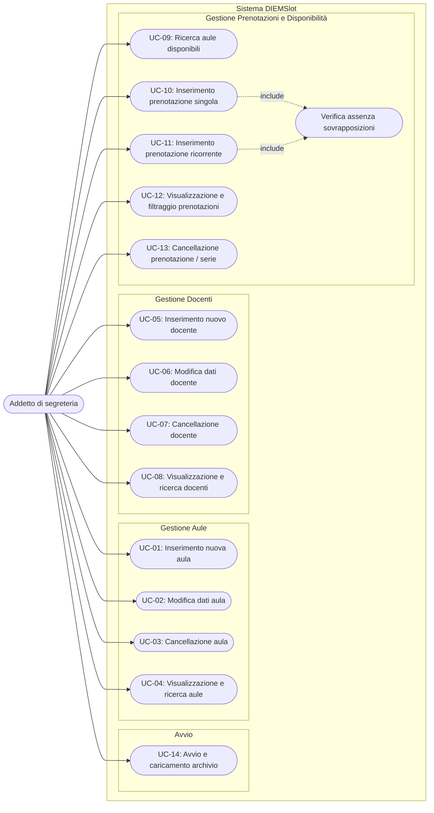

# DIEMSlot — Documento di Specifica dei Requisiti (SRS)

| Metadati Documento | Dettagli |
| :--- | :--- |
| **Progetto** | DIEMSlot — Sistema di Gestione e Prenotazione Aule Universitarie |
| **Corso** | Ingegneria del Software — DIEM, Università degli Studi di Salerno |
| **Versione** | 0.3 (Da rifinire nelle prossime fasi) |

---

## Indice

1. [Descrizione dell'applicazione](#1-descrizione-dellapplicazione)
   - [1.1 Scopo](#11-scopo)
   - [1.2 Attori](#12-attori)
   - [1.3 Entità del dominio](#13-entità-del-dominio)
   - [1.4 Funzionalità principali](#14-funzionalità-principali)
   - [1.5 Ipotesi e scelte progettuali](#15-ipotesi-e-scelte-progettuali)
   - [1.6 Fuori ambito](#16-fuori-ambito)
   - [1.7 Glossario](#17-glossario)
2. [Requisiti funzionali](#2-requisiti-funzionali)
   - [2.1 Business Flow principali](#21-business-flow-principali)
   - [2.2 Funzionalità individuali (Requisiti Funzionali)](#22-funzionalità-individuali-requisiti-funzionali)
   - [2.3 Requisiti relativi ai Dati](#23-requisiti-relativi-ai-dati)
   - [2.4 Requisiti dell'Interfaccia Utente](#24-requisiti-dellinterfaccia-utente)
3. [Requisiti non funzionali e vincoli](#3-requisiti-non-funzionali-e-vincoli)
   - [3.1 Requisiti Non Funzionali](#31-requisiti-non-funzionali)
   - [3.2 Vincoli di Progetto e Tecnologici](#32-vincoli-di-progetto-e-tecnologici)
4. [Casi d'uso](#4-casi-duso)
   - [4.1 Diagramma dei Casi d'Uso](#41-diagramma-dei-casi-duso)
   - [4.2 Descrizione dei singoli Casi d'Uso](#42-descrizione-dei-singoli-casi-duso)
5. [Matrice di tracciabilità](#5-matrice-di-tracciabilità)

---

## 1. Descrizione dell'applicazione

### 1.1 Scopo
**DIEMSlot** è un'applicazione desktop dotata di interfaccia grafica progettata per gestire le **aule**, i **docenti** e le **prenotazioni delle aule** di un dipartimento universitario (nella versione attuale il sistema si rivolge a un solo dipartimento. L'estensione è lasciata a future implementazioni).

Il sistema, gestito da un soggetto apposito, sostituisce la gestione manuale delle richieste di prenotazione, automatizzando la verifica delle disponibilità, impedendo sovrapposizioni temporali (sia per aula che per docente) e garantendo una consultazione rapida e ordinata dell'occupazione degli spazi.

### 1.2 Attori

| Attore | Descrizione |
| :--- | :--- |
| **Addetto di segreteria** | Unico attore (umano) che interagisce direttamente con il sistema. Gestisce l'anagrafica delle aule e dei docenti, consulta le disponibilità e registra/cancella le prenotazioni per conto dei docenti, i quali inoltrano le richieste tramite canali esterni al sistema (di persona, via mail o telefonicamente). |

I **docenti** non accedono direttamente all'applicazione: rappresentano entità del dominio rappresentate nel sistema e associate alle prenotazioni. Di conseguenza, non sono previsti meccanismi di autenticazione o schema di ruoli.

### 1.3 Entità del dominio

| Entità | Attributi | Note e Vincoli di Identificazione |
| :--- | :--- | :--- |
| **Aula** | `codice`, `nome`, `edificio`, `piano`, `capienza` | `codice` è l'identificativo univoco dell'aula; `capienza` è un intero positivo. |
| **Docente** | `email`, `nome`, `cognome` | `email` (indirizzo e-mail istituzionale) funge da codice identificativo univoco del docente. |
| **Prenotazione** | `aula`, `docente`, `tipoAttivita`, `denominazione`, `data`, `oraInizio`, `oraFine`, `idSerie` e `dataFineRicorrenza` (opzionali) | `tipoAttivita` assume valori predefiniti (es. *Lezione*, *Esame*, *Seminario*, *Altro*). Le prenotazioni ricorrenti condividono uno stesso identificativo di serie (`idSerie`); `dataFineRicorrenza` è presente solo nelle prenotazioni ricorrenti. |

### 1.4 Funzionalità principali
* **Gestione delle aule:** inserimento, modifica, cancellazione, visualizzazione dell'elenco completo e ricerca per nome, codice o capienza minima.
* **Gestione dei docenti:** inserimento, modifica, cancellazione, visualizzazione ordinata alfabeticamente per cognome e nome, e ricerca per cognome o indirizzo e-mail istituzionale.
* **Ricerca delle disponibilità:** individuazione e visualizzazione delle aule libere in una specifica data e fascia oraria.
* **Gestione delle prenotazioni:** inserimento di prenotazioni singole o ricorrenti a cadenza settimanale, visualizzazione ordinata cronologicamente per data e ora con possibilità di filtro per aula o per docente, cancellazione di una singola prenotazione oppure di tutte le prenotazioni successive appartenenti a una serie ricorrente.
* **Controllo automatico delle sovrapposizioni:** blocco dell'inserimento qualora un'aula risulti già impegnata o un docente risulti già assegnato a un'altra attività nella medesima fascia oraria.
* **Persistenza su file:** salvataggio automatico dell'intero archivio (aule, docenti e prenotazioni) su file locale e ripristino all'avvio dell'applicazione.

### 1.5 Ipotesi e scelte progettuali
Per risolvere le ambiguità della specifica informale, il team ha adottato formalmente le seguenti scelte progettuali:

| # | Ambito | Scelta Progettuale Adottata |
| :--- | :--- | :--- |
| 1 | **Utenza** | L'unico utente operativo è l'addetto di segreteria; non sono previsti login né gestione di sessioni o permessi. |
| 2 | **Perimetro organizzativo** | Il sistema gestisce le risorse di un singolo dipartimento universitario. |
| 3 | **Identificazione docenti** | L'indirizzo e-mail istituzionale costituisce il codice identificativo univoco del docente; la ricerca avviene per cognome o per e-mail. |
| 4 | **Identificazione aule** | L'aula è identificata univocamente dal proprio codice alfanumerico. |
| 5 | **Intervalli temporali** | Ogni prenotazione si svolge all'interno di una singola giornata solare con $\text{oraInizio} < \text{oraFine}$. Due prenotazioni adiacenti (in cui $\text{oraFine}$ della prima coincide con $\text{oraInizio}$ della seconda) **non** costituiscono conflitto. |
| 6 | **Ricorrenza settimanale** | Una prenotazione ricorrente genera occorrenze nello stesso giorno della settimana e nella stessa fascia oraria, a partire dalla data iniziale fino alla data di termine (inclusa). |
| 7 | **Gestione conflitti nelle serie** | L'inserimento di una serie ricorrente è atomico: se anche una sola occorrenza presenta una sovrapposizione (aula o docente), l'intera serie viene rifiutata e il sistema segnala le date in conflitto. |
| 8 | **Cancellazione serie ricorrente** | La cancellazione multipla rimuove l'occorrenza selezionata e tutte le occorrenze della medesima serie con data successiva a quella selezionata, preservando lo storico passato. |
| 9 | **Integrità referenziale** | Non è consentito eliminare un'aula o un docente che risultino associati ad almeno una prenotazione presente in archivio. |
| 10 | **Modifica prenotazioni** | La modifica diretta di una prenotazione non è prevista: per variare aula, docente o orario si procede alla cancellazione e al nuovo inserimento. |
| 11 | **Vincolo temporale** | Non è consentito inserire prenotazioni con data antecedente alla data odierna di sistema (o con orario di inizio già trascorso nella giornata corrente). |
| 12 | **Criteri di ricerca testuale** | Tutte le ricerche testuali (su nome/codice aula, cognome/e-mail docente) operano per sottostringa (*corrispondenza parziale*) e sono *case-insensitive*. |
| 13 | **Strategia di salvataggio** | L'archivio viene salvato su file locale automaticamente al termine di ogni operazione di inserimento, modifica o cancellazione. |

### 1.6 Fuori ambito
Non rientrano nel perimetro della versione corrente del sistema:

* l'accesso al sistema da parte di docenti o altri utenti esterni (consultazione delle disponibilità, richiesta autonoma di prenotazioni);
* autenticazione e gestione dei ruoli;
* architettura client-server e accesso da più postazioni contemporaneamente;
* ricorrenze diverse da quella settimanale;
* modifica diretta di una prenotazione esistente (vedi ipotesi 10);
* notifiche ai docenti.

Alcuni di questi punti potrebbero costituire sviluppi futuri.

### 1.7 Glossario

| Termine | Significato |
| :--- | :--- |
| **Prenotazione** | Assegnazione di un'aula a un docente per un'attività, in un intervallo di tempo. |
| **Serie ricorrente** | Insieme di prenotazioni generate da una stessa ricorrenza settimanale e identificate dallo stesso `idSerie`. |
| **Occorrenza** | Singola prenotazione appartenente a una serie ricorrente. |
| **Sovrapposizione (conflitto)** | Situazione in cui due prenotazioni si sovrappongono nel tempo per la stessa aula o per lo stesso docente. |
| **Archivio** | Insieme dei dati (aule, docenti, prenotazioni) gestiti dal sistema e salvati su file. |
| **Addetto di segreteria** | Operatore che utilizza il sistema. |

---

## 2. Requisiti funzionali

### 2.1 Business Flow principali

#### BF-01: Configurazione e manutenzione delle anagrafiche
1. L'addetto di segreteria avvia l'applicazione; il sistema carica automaticamente l'archivio esistente da file (oppure inizializza un archivio vuoto al primo avvio).
2. L'operatore censisce le aule del dipartimento inserendone codice, nome, edificio, piano e capienza.
3. L'operatore censisce i docenti inserendone indirizzo e-mail istituzionale, nome e cognome.
4. All'occorrenza, l'operatore aggiorna i dati anagrafici (es. cambio capienza aula o correzione nominativo) oppure rimuove entità non più attive (previa verifica dell'assenza di prenotazioni collegate).

#### BF-02: Gestione richiesta di prenotazione (singola o ricorrente)
1. Un docente richiede fuori sistema la prenotazione di un'aula per un'attività (lezione, esame, seminario) in una data e fascia oraria (eventualmente con ricorrenza settimanale).
2. L'addetto di segreteria consulta le aule disponibili nella data e fascia oraria richieste (filtrando eventualmente per capienza).
3. L'operatore compila i dati della prenotazione selezionando aula, docente, tipologia, denominazione e intervallo temporale.
4. Il sistema verifica l'assenza di sovrapposizioni sull'aula e sul docente (su tutte le settimane previste in caso di ricorrenza).
5. In assenza di conflitti, il sistema registra la prenotazione (o l'intera serie), aggiorna immediatamente il file di archivio e conferma l'operazione. In caso di conflitto, segnala il dettaglio delle sovrapposizioni senza alterare l'archivio.

#### BF-03: Consultazione e cancellazione delle prenotazioni
1. L'addetto di segreteria accede all'elenco cronologico delle prenotazioni, applicando eventuali filtri per aula o per docente.
2. Su richiesta di annullamento, l'operatore seleziona la prenotazione interessata.
3. Se la prenotazione fa parte di una serie ricorrente, l'operatore sceglie se annullare la singola occorrenza oppure l'occorrenza selezionata e tutte le successive.
4. Il sistema rimuove le prenotazioni interessate e aggiorna il file di archivio.

---

### 2.2 Funzionalità individuali (Requisiti Funzionali)

Legenda priorità: **Alta** (*indispensabile per il funzionamento core*), **Media** (*funzionalità di supporto o ricerca avanzata*), **Bassa** (*miglioria opzionale*).

| Codice | Categoria | Descrizione del Requisito | Priorità | Casi d'Uso Correlati |
| :--- | :--- | :--- | :---: | :---: |
| **RF-AUL-01** | Gestione Aule | Il sistema deve consentire l'inserimento di una nuova aula specificando codice univoco, nome, edificio, piano e capienza, rifiutando codici già presenti in archivio. | **Alta** | `UC-01` |
| **RF-AUL-02** | Gestione Aule | Il sistema deve consentire la modifica degli attributi (`nome`, `edificio`, `piano`, `capienza`) di un'aula esistente. | **Media** | `UC-02` |
| **RF-AUL-03** | Gestione Aule | Il sistema deve consentire la cancellazione di un'aula esistente, bloccando l'operazione se all'aula risultano associate una o più prenotazioni. | **Alta** | `UC-03` |
| **RF-AUL-04** | Gestione Aule | Il sistema deve visualizzare l'elenco completo delle aule registrate in archivio. | **Alta** | `UC-04` |
| **RF-AUL-05** | Gestione Aule | Il sistema deve consentire la ricerca di aule filtrando per codice (corrispondenza parziale case-insensitive), per nome (corrispondenza parziale case-insensitive) e/o per capienza minima ($\ge$ valore inserito). | **Media** | `UC-04` |
| **RF-DOC-01** | Gestione Docenti | Il sistema deve consentire l'inserimento di un nuovo docente specificando e-mail istituzionale univoca, nome e cognome, rifiutando indirizzi e-mail già presenti in archivio. | **Alta** | `UC-05` |
| **RF-DOC-02** | Gestione Docenti | Il sistema deve consentire la modifica dei dati (`nome`, `cognome`) di un docente esistente. | **Media** | `UC-06` |
| **RF-DOC-03** | Gestione Docenti | Il sistema deve consentire la cancellazione di un docente esistente, bloccando l'operazione se al docente risultano associate una o più prenotazioni. | **Alta** | `UC-07` |
| **RF-DOC-04** | Gestione Docenti | Il sistema deve visualizzare l'elenco dei docenti ordinato alfabeticamente per cognome e, a parità di cognome, per nome. | **Alta** | `UC-08` |
| **RF-DOC-05** | Gestione Docenti | Il sistema deve consentire la ricerca di docenti filtrando per cognome o per indirizzo e-mail istituzionale (corrispondenza parziale case-insensitive). | **Media** | `UC-08` |
| **RF-PRE-01** | Gestione Prenotazioni | Il sistema deve consentire di ricercare e visualizzare l'elenco delle aule libere (prive di prenotazioni sovrapposte) in una determinata data e fascia oraria $[\text{oraInizio}, \text{oraFine})$. | **Alta** | `UC-09` |
| **RF-PRE-02** | Gestione Prenotazioni | Il sistema deve consentire l'inserimento di una prenotazione singola associando aula, docente, tipo di attività, denominazione, data, ora di inizio e ora di fine. | **Alta** | `UC-10` |
| **RF-PRE-03** | Gestione Prenotazioni | Il sistema deve consentire l'inserimento di una prenotazione ricorrente a cadenza settimanale fino a una data di termine inclusa, generando le relative occorrenze settimanali. | **Alta** | `UC-11` |
| **RF-PRE-04** | Gestione Prenotazioni | Prima di confermare una prenotazione singola o ricorrente, il sistema deve verificare che per ogni occorrenza non esistano prenotazioni sovrapposte né sulla stessa aula né sullo stesso docente; in caso di conflitto deve rifiutare l'inserimento e indicarne la causa. | **Alta** | `UC-10`, `UC-11` |
| **RF-PRE-05** | Gestione Prenotazioni | Il sistema deve visualizzare l'elenco delle prenotazioni ordinato cronologicamente per data e ora di inizio. | **Alta** | `UC-12` |
| **RF-PRE-06** | Gestione Prenotazioni | Il sistema deve consentire di filtrare l'elenco delle prenotazioni per aula specifica oppure per docente specifico. | **Media** | `UC-12` |
| **RF-PRE-07** | Gestione Prenotazioni | Il sistema deve consentire la cancellazione di una singola prenotazione selezionata. | **Alta** | `UC-13` |
| **RF-PRE-08** | Gestione Prenotazioni | Per una prenotazione appartenente a una serie ricorrente, il sistema deve consentire la cancellazione dell'occorrenza selezionata insieme a tutte le occorrenze successive della medesima serie. | **Alta** | `UC-13` |
| **RF-PER-01** | Persistenza | All'avvio dell'applicazione, il sistema deve caricare automaticamente lo stato di aule, docenti e prenotazioni dal file di archivio locale. | **Alta** | `UC-14` |
| **RF-PER-02** | Persistenza | Al termine di ogni operazione di inserimento, modifica o cancellazione di aule, docenti o prenotazioni, il sistema deve salvare automaticamente lo stato aggiornato sul file di archivio locale. | **Alta** | `UC-01`..`UC-03`, `UC-05`..`UC-07`, `UC-10`, `UC-11`, `UC-13` |

---

### 2.3 Requisiti relativi ai Dati

| Codice | Categoria | Descrizione del Requisito | Priorità |
| :--- | :--- | :--- | :---: |
| **RD-01** | Integrità e Unicità | Il codice identificativo dell'aula non può essere vuoto o nullo e deve essere univoco nell'archivio (confronto case-insensitive). | **Alta** |
| **RD-02** | Validazione Dati | La capienza di un'aula deve essere un numero intero strettamente maggiore di zero ($\text{capienza} > 0$); il piano deve essere un numero intero valido (anche negativo per piani seminterrati). | **Alta** |
| **RD-03** | Integrità e Unicità | L'indirizzo e-mail istituzionale del docente deve rispettare un formato e-mail sintatticamente valido e deve essere univoco nell'archivio (confronto case-insensitive). | **Alta** |
| **RD-04** | Validazione Dati | I campi testuali obbligatori (`nome` aula, `edificio`, `nome` e `cognome` docente, `tipoAttivita`, `denominazione`) non possono essere nulli o composti da soli spazi bianchi. | **Alta** |
| **RD-05** | Validazione Temporale | In ogni prenotazione, `oraInizio` deve essere strettamente precedente a `oraFine` ($\text{oraInizio} < \text{oraFine}$) e la `data` non può essere antecedente alla data corrente di sistema. | **Alta** |
| **RD-06** | Validazione Ricorrenza | Nelle prenotazioni ricorrenti, la `dataFineRicorrenza` deve essere maggiore o uguale alla `data` della prima occorrenza ($\text{dataFineRicorrenza} \ge \text{data}$). | **Alta** |

---

### 2.4 Requisiti dell'Interfaccia Utente

| Codice | Categoria | Descrizione del Requisito | Priorità |
| :--- | :--- | :--- | :---: |
| **RUI-01** | Struttura Navigazione | L'interfaccia grafica deve organizzare le funzionalità in sezioni distinte e raggiungibili direttamente dall'operatore: gestione delle prenotazioni, delle aule, dei docenti e ricerca delle disponibilità. | **Alta** |
| **RUI-02** | Visualizzazione Tabellare | Gli elenchi di aule, docenti e prenotazioni devono essere presentati in forma tabellare, con intestazioni esplicite per ciascun attributo. | **Alta** |
| **RUI-03** | Feedback Operativo | Ogni operazione non valida (campi mancanti, duplicati, violazione integrità referenziale, conflitto orario) deve mostrare un messaggio di avviso chiaro che spieghi il motivo del blocco, senza causare la chiusura anomala dell'applicazione. | **Alta** |
| **RUI-04** | Conferma Azioni Distruttive | Prima di eseguire qualsiasi operazione di cancellazione (aula, docente, prenotazione singola o serie ricorrente), l'interfaccia deve richiedere conferma esplicita all'operatore. | **Media** |
| **RUI-05** | Selezione Guidata | Nei moduli di inserimento prenotazione e di filtraggio, la selezione di aula, docente, tipologia di attività, date e orari deve avvenire tramite elenchi di scelta e selettori dedicati, per minimizzare gli errori di digitazione. | **Bassa** |

---

## 3. Requisiti non funzionali e vincoli

### 3.1 Requisiti Non Funzionali

| Codice | Categoria | Descrizione del Requisito | Priorità |
| :--- | :--- | :--- | :---: |
| **RNF-01** | Affidabilità / Persistenza | Il meccanismo di lettura e scrittura su file deve gestire l'assenza del file al primo avvio (inizializzando un archivio vuoto) e notificare eventuali errori di I/O senza corrompere i dati preesistenti. | **Alta** |
| **RNF-02** | Manutenibilità / Architettura | Il sistema deve adottare una netta separazione delle responsabilità tra modello del dominio, logica applicativa, persistenza e interfaccia grafica, evitando che modello e logica applicativa dipendano dal framework grafico. | **Alta** |
| **RNF-03** | Testabilità | Tutte le classi contenenti logica di dominio, validazione, ricerca e persistenza devono essere verificabili tramite Unit Test automatizzati eseguiti senza necessità di avviare l'interfaccia grafica. | **Alta** |
| **RNF-04** | Prestazioni | Le operazioni di ricerca disponibilità, filtraggio e verifica dei conflitti su un archivio di dimensioni dipartimentali tipiche (ordine di 100 aule, 500 docenti e 5.000 prenotazioni) devono completarsi in meno di $1\text{ s}$. | **Media** |
| **RNF-05** | Portabilità | L'applicazione deve essere eseguibile senza modifiche al codice sorgente sui principali sistemi operativi desktop (Windows, Linux, macOS) dotati di Java Runtime Environment compatibile. | **Bassa** |
| **RNF-06** | Documentazione | Tutte le classi e i metodi pubblici devono essere documentati mediante commenti strutturati compatibili con Doxygen. | **Alta** |

### 3.2 Vincoli di Progetto e Tecnologici
*(Per specifica progettuale, tutti i vincoli hanno priorità **Massima**).*

| Codice | Categoria | Descrizione del Vincolo | Priorità |
| :--- | :--- | :--- | :---: |
| **VIN-01** | Linguaggio | L'applicazione deve essere sviluppata in linguaggio **Java** (JDK $\ge 17$). | **Massima** |
| **VIN-02** | Framework GUI | L'interfaccia grafica desktop deve essere realizzata utilizzando **JavaFX**. | **Massima** |
| **VIN-03** | Build Automation | La struttura del progetto, le dipendenze e la compilazione devono essere gestite tramite **Apache Maven** (`pom.xml`). | **Massima** |
| **VIN-04** | Framework di Testing | I test unitari automatizzati devono essere implementati con **JUnit 5** (JUnit Jupiter) ed essere eseguibili tramite comando `mvn test`. | **Massima** |
| **VIN-05** | Persistenza Dati | La memorizzazione permanente dei dati deve avvenire esclusivamente su **file locale** (senza l'impiego di DBMS esterni). | **Massima** |
| **VIN-06** | Documentazione Codice | La generazione della documentazione tecnica delle interfacce deve essere supportata tramite **Doxygen**. | **Massima** |
| **VIN-07** | Controllo Versione | Il codice sorgente e la documentazione di progetto devono essere ospitati su un repository pubblico **GitHub** gestito tramite **Git**. | **Massima** |

---

## 4. Casi d'uso

### 4.1 Diagramma dei Casi d'Uso

---

### 4.2 Descrizione dei singoli Casi d'Uso

#### UC-01: Inserimento nuova aula
| Campo | Descrizione |
| :--- | :--- |
| **Attore** | Addetto di segreteria |
| **Requisiti correlati** | `RF-AUL-01`, `RF-PER-02`, `RD-01`, `RD-02`, `RD-04`, `RUI-03` |
| **Precondizioni** | L'applicazione è avviata e l'operatore si trova nella sezione *Gestione Aule*. |
| **Postcondizioni** | La nuova aula è registrata nell'archivio in memoria e salvata sul file locale. |
| **Scenario Principale** | 1. L'operatore avvia l'inserimento di una nuova aula. 2. L'operatore inserisce `codice`, `nome`, `edificio`, `piano` e `capienza`. 3. L'operatore conferma l'operazione. 4. Il sistema valida i campi e verifica che il codice non sia già presente. 5. Il sistema aggiunge l'aula all'archivio, salva su file e aggiorna la tabella a schermo. |
| **Scenari Alternativi** | **4a. Campi mancanti o non validi** (es. $\text{capienza} \le 0$ o testo vuoto): il sistema mostra un messaggio di errore e annulla l'inserimento. **4b. Codice aula duplicato**: il sistema segnala che esiste già un'aula con lo stesso codice e richiede la correzione. |

---

#### UC-02: Modifica dati aula
| Campo | Descrizione |
| :--- | :--- |
| **Attore** | Addetto di segreteria |
| **Requisiti correlati** | `RF-AUL-02`, `RF-PER-02`, `RD-02`, `RD-04`, `RUI-03` |
| **Precondizioni** | Esiste almeno un'aula in archivio e l'operatore l'ha selezionata nella sezione *Gestione Aule*. |
| **Postcondizioni** | I dati dell'aula selezionata sono aggiornati in archivio e salvati su file. |
| **Scenario Principale** | 1. L'operatore seleziona un'aula dall'elenco e attiva la modifica. 2. Il sistema mostra i dati correnti dell'aula. 3. L'operatore modifica uno o più campi consentiti (`nome`, `edificio`, `piano`, `capienza`) e conferma. 4. Il sistema valida i nuovi valori, aggiorna l'aula, salva su file e aggiorna la vista. |
| **Scenari Alternativi** | **4a. Valori non validi** (es. $\text{capienza} \le 0$): il sistema mostra un messaggio di errore e mantiene i dati precedenti. |

---

#### UC-03: Cancellazione aula
| Campo | Descrizione |
| :--- | :--- |
| **Attore** | Addetto di segreteria |
| **Requisiti correlati** | `RF-AUL-03`, `RF-PER-02`, `RUI-03`, `RUI-04` |
| **Precondizioni** | Esiste almeno un'aula in archivio e l'operatore l'ha selezionata. |
| **Postcondizioni** | L'aula selezionata è rimossa dall'archivio e il file locale è aggiornato. |
| **Scenario Principale** | 1. L'operatore seleziona un'aula e richiede la cancellazione. 2. Il sistema verifica che l'aula non sia associata ad alcuna prenotazione in archivio. 3. Il sistema chiede conferma dell'operazione. 4. L'operatore conferma; il sistema rimuove l'aula, salva su file e aggiorna l'elenco. |
| **Scenari Alternativi** | **2a. Aula associata a prenotazioni**: il sistema blocca la cancellazione e avvisa l'operatore che l'aula ha prenotazioni registrate. **4a. L'operatore annulla la conferma**: l'operazione viene interrotta senza modifiche. |

---

#### UC-04: Visualizzazione e ricerca aule
| Campo | Descrizione |
| :--- | :--- |
| **Attore** | Addetto di segreteria |
| **Requisiti correlati** | `RF-AUL-04`, `RF-AUL-05`, `RUI-02` |
| **Precondizioni** | L'applicazione è avviata. |
| **Postcondizioni** | L'elenco completo o filtrato delle aule è visualizzato nella tabella. |
| **Scenario Principale** | 1. L'operatore accede alla sezione *Gestione Aule*. 2. Il sistema mostra la tabella con tutte le aule presenti in archivio. 3. L'operatore inserisce criteri di ricerca (testo per codice/nome e/o capienza minima). 4. Il sistema filtra in tempo reale le aule che soddisfano tutti i criteri impostati. |
| **Scenari Alternativi** | **4a. Nessuna aula corrisponde ai criteri**: il sistema mostra la tabella vuota. |

---

#### UC-05: Inserimento nuovo docente
| Campo | Descrizione |
| :--- | :--- |
| **Attore** | Addetto di segreteria |
| **Requisiti correlati** | `RF-DOC-01`, `RF-PER-02`, `RD-03`, `RD-04`, `RUI-03` |
| **Precondizioni** | L'operatore si trova nella sezione *Gestione Docenti*. |
| **Postcondizioni** | Il nuovo docente è registrato in archivio e salvato su file. |
| **Scenario Principale** | 1. L'operatore avvia l'inserimento di un nuovo docente. 2. L'operatore inserisce `email` istituzionale, `nome` e `cognome` e conferma. 3. Il sistema verifica la validità sintattica dell'e-mail, l'obbligatorietà dei campi e l'univocità dell'e-mail. 4. Il sistema salva il docente in archivio, aggiorna il file e ridisegna la tabella ordinata. |
| **Scenari Alternativi** | **3a. E-mail non valida o campi vuoti**: il sistema mostra un errore di validazione. **3b. E-mail già presente in archivio**: il sistema segnala la duplicazione e blocca l'inserimento. |

---

#### UC-06: Modifica dati docente
| Campo | Descrizione |
| :--- | :--- |
| **Attore** | Addetto di segreteria |
| **Requisiti correlati** | `RF-DOC-02`, `RF-PER-02`, `RD-04`, `RUI-03` |
| **Precondizioni** | Esiste almeno un docente in archivio e l'operatore lo ha selezionato. |
| **Postcondizioni** | I dati anagrafici del docente sono aggiornati in archivio e salvati su file. |
| **Scenario Principale** | 1. L'operatore seleziona un docente e avvia la modifica. 2. L'operatore aggiorna `nome` e/o `cognome` e conferma. 3. Il sistema valida i campi, aggiorna il docente, salva su file e riordina l'elenco. |
| **Scenari Alternativi** | **3a. Campi lasciati vuoti**: il sistema mostra un avviso di errore e annulla la modifica. |

---

#### UC-07: Cancellazione docente
| Campo | Descrizione |
| :--- | :--- |
| **Attore** | Addetto di segreteria |
| **Requisiti correlati** | `RF-DOC-03`, `RF-PER-02`, `RUI-03`, `RUI-04` |
| **Precondizioni** | Esiste almeno un docente in archivio e l'operatore lo ha selezionato. |
| **Postcondizioni** | Il docente selezionato è rimosso dall'archivio e dal file locale. |
| **Scenario Principale** | 1. L'operatore seleziona un docente e richiede la cancellazione. 2. Il sistema verifica che il docente non sia associato ad alcuna prenotazione in archivio. 3. Il sistema richiede conferma all'operatore. 4. L'operatore conferma; il sistema rimuove il docente, salva su file e aggiorna la tabella. |
| **Scenari Alternativi** | **2a. Docente associato a prenotazioni**: il sistema impedisce l'eliminazione e avvisa l'operatore. **4a. Annullamento conferma**: nessuna modifica viene applicata. |

---

#### UC-08: Visualizzazione e ricerca docenti
| Campo | Descrizione |
| :--- | :--- |
| **Attore** | Addetto di segreteria |
| **Requisiti correlati** | `RF-DOC-04`, `RF-DOC-05`, `RUI-02` |
| **Precondizioni** | L'applicazione è avviata. |
| **Postcondizioni** | L'elenco dei docenti è visualizzato ordinato per cognome e nome, eventualmente filtrato. |
| **Scenario Principale** | 1. L'operatore accede alla sezione *Gestione Docenti*. 2. Il sistema mostra tutti i docenti ordinati alfabeticamente per `cognome` e poi per `nome`. 3. L'operatore inserisce una chiave di ricerca (cognome o e-mail). 4. Il sistema visualizza i soli docenti che corrispondono al criterio mantenendo l'ordinamento alfabetico. |
| **Scenari Alternativi** | **4a. Nessun riscontro**: viene mostrata una tabella vuota. |

---

#### UC-09: Ricerca aule disponibili
| Campo | Descrizione |
| :--- | :--- |
| **Attore** | Addetto di segreteria |
| **Requisiti correlati** | `RF-PRE-01`, `RD-05`, `RUI-03`, `RUI-05` |
| **Precondizioni** | Esistono aule censite in archivio. |
| **Postcondizioni** | Viene mostrato l'elenco delle aule libere nell'intervallo temporale richiesto. |
| **Scenario Principale** | 1. L'operatore seleziona una `data`, un `oraInizio` e un `oraFine` (e opzionalmente una capienza minima). 2. L'operatore avvia la ricerca disponibilità. 3. Il sistema verifica che $\text{oraInizio} < \text{oraFine}$. 4. Il sistema individua tutte le aule che non hanno prenotazioni sovrapposte nella data e fascia oraria indicate e le presenta all'operatore. |
| **Scenari Alternativi** | **3a. Intervallo orario non valido** ($\text{oraInizio} \ge \text{oraFine}$): il sistema segnala l'errore di inserimento. **4a. Tutte le aule risultano occupate**: il sistema comunica che non vi sono aule disponibili per la fascia richiesta. |

---

#### UC-10: Inserimento prenotazione singola
| Campo | Descrizione |
| :--- | :--- |
| **Attore** | Addetto di segreteria |
| **Requisiti correlati** | `RF-PRE-02`, `RF-PRE-04`, `RF-PER-02`, `RD-04`, `RD-05`, `RUI-03`, `RUI-05` |
| **Precondizioni** | In archivio esistono almeno un'aula e almeno un docente. |
| **Postcondizioni** | La prenotazione singola è aggiunta all'archivio e salvata su file. |
| **Scenario Principale** | 1. L'operatore avvia l'inserimento di una prenotazione in modalità *Singola*. 2. L'operatore seleziona `aula`, `docente`, `tipoAttivita`, `denominazione`, `data`, `oraInizio` e `oraFine`. 3. L'operatore conferma. 4. Il sistema valida i dati e include la verifica di assenza sovrapposizioni sull'aula e sul docente. 5. Il sistema registra la prenotazione, salva su file e aggiorna l'elenco prenotazioni. |
| **Scenari Alternativi** | **4a. Dati mancanti, data/ora nel passato oppure $\text{oraInizio} \ge \text{oraFine}$**: il sistema rifiuta l'operazione con un messaggio esplicativo. **4b. Conflitto rilevato (aula occupata o docente già impegnato)**: il sistema blocca l'inserimento indicando i dettagli della prenotazione in conflitto. |

---

#### UC-11: Inserimento prenotazione ricorrente settimanale
| Campo | Descrizione |
| :--- | :--- |
| **Attore** | Addetto di segreteria |
| **Requisiti correlati** | `RF-PRE-03`, `RF-PRE-04`, `RF-PER-02`, `RD-04`, `RD-05`, `RD-06`, `RUI-03`, `RUI-05` |
| **Precondizioni** | In archivio esistono almeno un'aula e almeno un docente. |
| **Postcondizioni** | Tutte le occorrenze settimanali generate sono registrate in archivio con un medesimo identificativo di serie e salvate su file. |
| **Scenario Principale** | 1. L'operatore avvia l'inserimento di una prenotazione selezionando l'opzione *Ricorrente settimanale*. 2. L'operatore inserisce `aula`, `docente`, `tipoAttivita`, `denominazione`, `data` di inizio, `dataFineRicorrenza`, `oraInizio` e `oraFine`. 3. Il sistema genera l'elenco delle date a cadenza settimanale da `data` a `dataFineRicorrenza` inclusa. 4. Il sistema verifica l'assenza di sovrapposizioni (aula e docente) per **ciascuna** occorrenza generata. 5. Se tutte le occorrenze sono valide, il sistema assegna un `idSerie` univoco, le salva in blocco nell'archivio e su file, e aggiorna la vista. |
| **Scenari Alternativi** | **3a. $\text{dataFineRicorrenza} < \text{data}$**: il sistema segnala l'errore sull'intervallo di ricorrenza. **4a. Conflitto su una o più occorrenze**: il sistema annulla atomicamente l'intera serie e mostra l'elenco delle date in cui si verifica una sovrapposizione. |

---

#### UC-12: Visualizzazione e filtraggio prenotazioni
| Campo | Descrizione |
| :--- | :--- |
| **Attore** | Addetto di segreteria |
| **Requisiti correlati** | `RF-PRE-05`, `RF-PRE-06`, `RUI-02`, `RUI-05` |
| **Precondizioni** | L'applicazione è avviata. |
| **Postcondizioni** | Le prenotazioni sono mostrate in ordine cronologico, eventualmente filtrate per aula o docente. |
| **Scenario Principale** | 1. L'operatore accede alla sezione *Prenotazioni*. 2. Il sistema visualizza tutte le prenotazioni ordinate cronologicamente per `data` e `oraInizio`. 3. L'operatore seleziona un filtro (un'aula specifica oppure un docente specifico). 4. Il sistema aggiorna la tabella mostrando le sole prenotazioni relative all'aula o al docente selezionato, mantenendo l'ordine cronologico. |
| **Scenari Alternativi** | **3a. Rimozione filtro**: l'operatore azzera il filtro e torna a visualizzare l'intero archivio prenotazioni. |

---

#### UC-13: Cancellazione prenotazione (singola o serie successiva)
| Campo | Descrizione |
| :--- | :--- |
| **Attore** | Addetto di segreteria |
| **Requisiti correlati** | `RF-PRE-07`, `RF-PRE-08`, `RF-PER-02`, `RUI-04` |
| **Precondizioni** | Esiste almeno una prenotazione in archivio e l'operatore l'ha selezionata nella tabella. |
| **Postcondizioni** | La singola prenotazione oppure l'occorrenza selezionata e tutte le successive della stessa serie sono rimosse dall'archivio e dal file. |
| **Scenario Principale** | 1. L'operatore seleziona una prenotazione dall'elenco e richiede la cancellazione. 2. Se la prenotazione è **singola**, il sistema chiede conferma ed elimina quella specifica prenotazione. 3. Se la prenotazione appartiene a una **serie ricorrente**, il sistema chiede all'operatore se intende eliminare:    - *solo l'occorrenza selezionata*; oppure    - *l'occorrenza selezionata e tutte le occorrenze successive della serie*. 4. L'operatore conferma la scelta; il sistema rimuove le prenotazioni interessate, salva su file e aggiorna la tabella. |
| **Scenari Alternativi** | **4a. Annullamento dell'operazione**: il sistema chiude la finestra di dialogo senza eliminare alcuna prenotazione. |

---

#### UC-14: Avvio e caricamento archivio
| Campo | Descrizione |
| :--- | :--- |
| **Attore** | Addetto di segreteria |
| **Requisiti correlati** | `RF-PER-01`, `RNF-01` |
| **Precondizioni** | L'applicazione non è in esecuzione. |
| **Postcondizioni** | Lo stato di aule, docenti e prenotazioni è disponibile in memoria e l'interfaccia è operativa. |
| **Scenario Principale** | 1. L'operatore avvia l'applicazione. 2. Il sistema cerca il file di archivio locale. 3. Il sistema carica aule, docenti e prenotazioni dal file. 4. Il sistema mostra l'interfaccia principale con i dati caricati. |
| **Scenari Alternativi** | **2a. File di archivio assente (primo avvio)**: il sistema inizializza un archivio vuoto e prosegue dal passo 4. **3a. File illeggibile o con contenuto non valido**: il sistema segnala l'errore all'operatore e non modifica il file esistente. |

---

## 5. Matrice di tracciabilità

> **Nota metodologica:** La presente tabella collega ogni requisito ai Casi d'Uso definiti in fase di analisi. Le colonne relative ai **Componenti** (package/classi/metodi) e ai **Casi di Test** saranno compilate al termine delle fasi di *Design* (7 Dicembre) e *Implementazione e Testing* (14 Dicembre).

| Codice Requisito | Caso d'Uso | Componenti (Package / Classe / Metodo) | Casi di Test | Stato |
| :--- | :--- | :--- | :--- | :---: |
| **RF-AUL-01** | `UC-01` | *da definire in fase di design* | *da definire* | Da implementare |
| **RF-AUL-02** | `UC-02` | *da definire in fase di design* | *da definire* | Da implementare |
| **RF-AUL-03** | `UC-03` | *da definire in fase di design* | *da definire* | Da implementare |
| **RF-AUL-04** | `UC-04` | *da definire in fase di design* | *da definire* | Da implementare |
| **RF-AUL-05** | `UC-04` | *da definire in fase di design* | *da definire* | Da implementare |
| **RF-DOC-01** | `UC-05` | *da definire in fase di design* | *da definire* | Da implementare |
| **RF-DOC-02** | `UC-06` | *da definire in fase di design* | *da definire* | Da implementare |
| **RF-DOC-03** | `UC-07` | *da definire in fase di design* | *da definire* | Da implementare |
| **RF-DOC-04** | `UC-08` | *da definire in fase di design* | *da definire* | Da implementare |
| **RF-DOC-05** | `UC-08` | *da definire in fase di design* | *da definire* | Da implementare |
| **RF-PRE-01** | `UC-09` | *da definire in fase di design* | *da definire* | Da implementare |
| **RF-PRE-02** | `UC-10` | *da definire in fase di design* | *da definire* | Da implementare |
| **RF-PRE-03** | `UC-11` | *da definire in fase di design* | *da definire* | Da implementare |
| **RF-PRE-04** | `UC-10`, `UC-11` | *da definire in fase di design* | *da definire* | Da implementare |
| **RF-PRE-05** | `UC-12` | *da definire in fase di design* | *da definire* | Da implementare |
| **RF-PRE-06** | `UC-12` | *da definire in fase di design* | *da definire* | Da implementare |
| **RF-PRE-07** | `UC-13` | *da definire in fase di design* | *da definire* | Da implementare |
| **RF-PRE-08** | `UC-13` | *da definire in fase di design* | *da definire* | Da implementare |
| **RF-PER-01** | `UC-14` | *da definire in fase di design* | *da definire* | Da implementare |
| **RF-PER-02** | `UC-01`..`UC-03`, `UC-05`..`UC-07`, `UC-10`, `UC-11`, `UC-13` | *da definire in fase di design* | *da definire* | Da implementare |
| **RD-01..06** | `UC-01`, `UC-02`, `UC-05`, `UC-06`, `UC-09`..`UC-11` | *da definire in fase di design* | *da definire* | Da implementare |
| **RUI-01..05** | Tutti | *da definire in fase di design* | Verifica funzionale manuale (GUI esclusa dagli unit test) | Da implementare |
| **RNF-01** | `UC-14` | *da definire in fase di design* | *da definire* | Da implementare |
| **RNF-02..06** | — | *da definire in fase di design* | *da definire* | Da implementare |
| **VIN-01..07** | — | `pom.xml`, `Doxyfile`, repository GitHub | `mvn clean test` | Da verificare |
